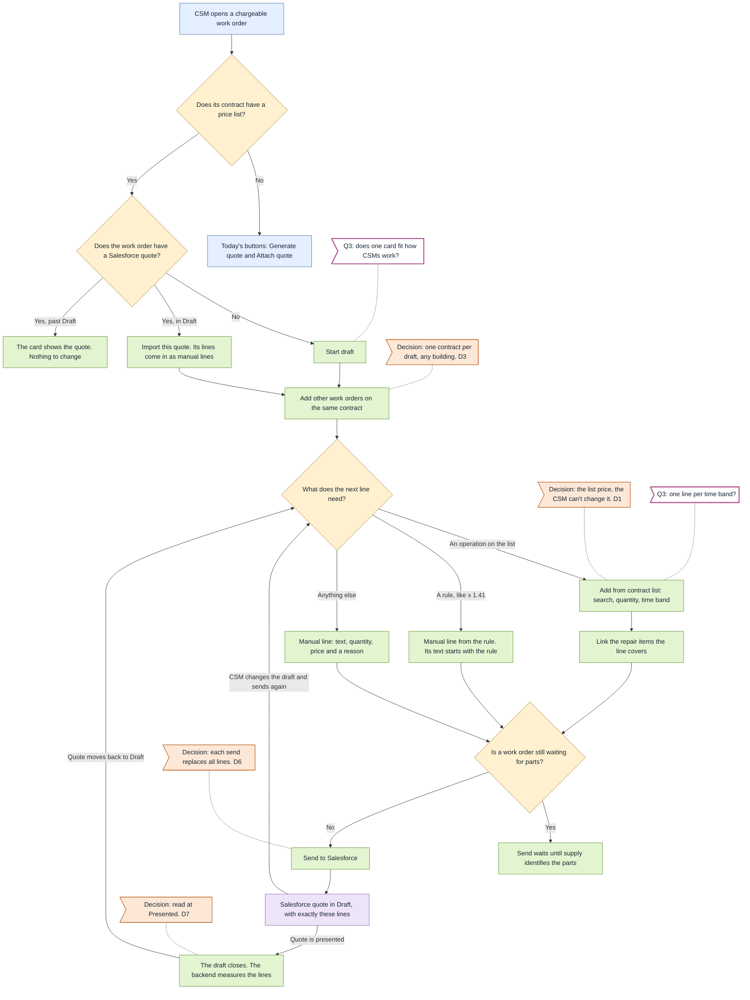
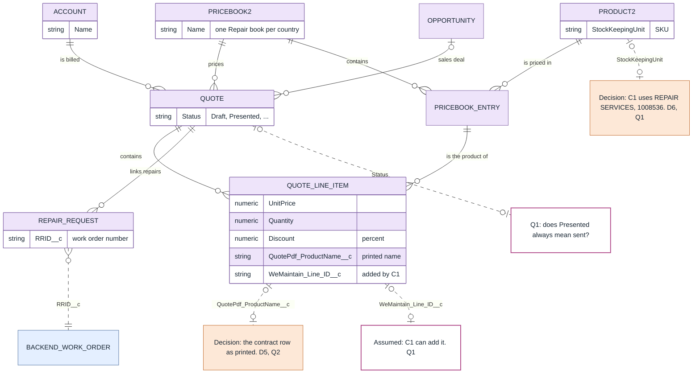
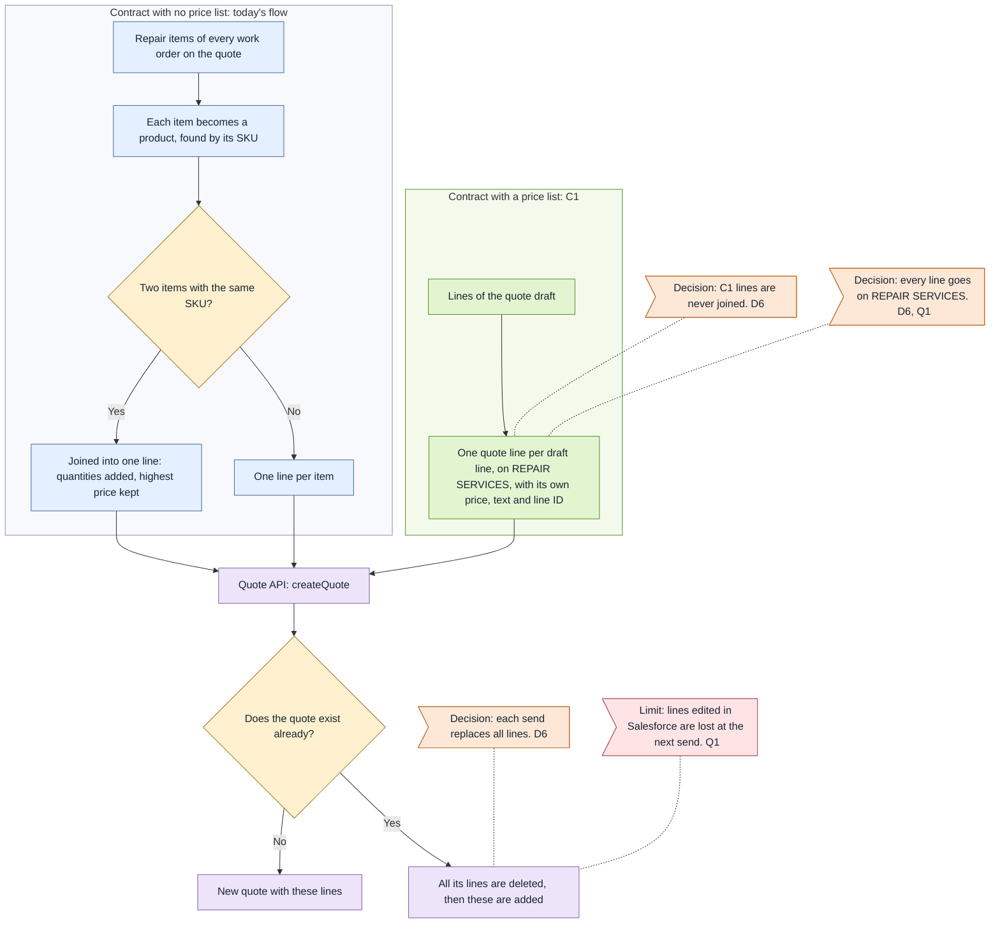

# C1: contract price lists in quoting

Appetite: one engineer, two weeks

# Problem

On contracts with a Schedule of Rates (SoR), CSMs must find each price in the contract PDF and retype it in the Salesforce quote. 

# Solution

This specification adds support for the price lists into WeMaintain’s backend. On a contract with a price list, every quote line is either a contract line at the list price or a manual line with a reason. Salesforce receives the finished lines and each line also links to the repair items it covers. These links are training data for C2's matcher, and C3 can then fill the same quote draft automatically using those matches. Moreover, since every line links where its price came from, C4 can later check prices and add rules on top. The proposal also includes an observability strategy to measure the success of these changes.

# Try it

Running the app loads the two price lists as defined in `exploration/price-lists/` and links them to six contracts. Two of them use Lindenhome's list and the rest use Meridian's.

> [why] Analysis of the price lists showed that there were existing customers using ad-hoc lines for repairs that could be matched with a code in the price list. We assumed these customers could use, for the purposes of this prototype and the implementation of C1, the prices in these lists.
>
> How we matched them: we looked at the lines of past quotes for each contract. For Lindenhome, a line counts when it names a list code and has the list price. For Meridian, a line counts when its price is a Table A price. Some contracts were also read by the exploration. The queries are in `shaping/analysis/03-which-contract-uses-which-list.sql`.
>
> - Lindenhome's list:
>   - 00019814, Lindenhome AL's main contract: 89 past quote lines use a list code at the list price.
>   - 00016840, Lindenhome AL: R26-17700 was quoted as 0435AS at the list price.
> - Meridian's Table A:
>   - 00018461, Meridian Kembang: 12 of 16 past lines are at Table A prices.
>   - 00016613, MR Retail Trustee: the exploration read the contract, and 20 of 22 past lines are at Table A prices.
>   - 00016179, Serava Mall: the exploration read the contract, and 9 of 11 past lines are at Table A prices.
>   - 00014296, Meridian Lumière: the exploration read the contract.
> - Not linked:
>   - 00017624, Kembang's second contract: no past price shows that it uses Table A.
>   - North Gem 00016251 and Ardmoor's contracts: past quotes charge other prices than Table A for the same work.
>   - Lindenhome PM: its quotes use an earlier list, which we don't have.

- Run `pnpm dev`. Every time the app starts, the database resets and the price lists are re-imported. Your changes won't survive a server restart.
- Use the dashboard's filters to display work orders with a price list linked and that are chargeable.

Based on the Salesforce quote status different paths are available in the UI:

1. Work orders without a Salesforce quote:
- In these orders the UI allows the CSM to start a new quote and pick the quote items from the price list.
- Example work orders:
  - http://localhost:5173/work-orders/details/R26-15442
  - http://localhost:5173/work-orders/details/R26-15429 (with parts to estimate)
  - http://localhost:5173/work-orders/details/R26-11707 (with time band price picking)

2. Work orders with a Salesforce quote in Draft:
- These orders allow the CSM to "Import" the quote into the WeMaintain system. The import mechanism will bring existing data from Salesforce and allow the CSM to add the proper price list codes to the quote.
- Example work orders:
  - http://localhost:5173/work-orders/details/R26-11156
  - http://localhost:5173/work-orders/details/R26-05868
  - http://localhost:5173/work-orders/details/R26-15307 (with parts to estimate)
  - http://localhost:5173/work-orders/details/R26-12974 (with time band price picking)

3. Work orders with a quote in Salesforce that is past Draft:
- These orders receive an improved UI, but the CSM can't modify the quote.
- Example work orders:
  - http://localhost:5173/work-orders/details/R26-18174
  - http://localhost:5173/work-orders/details/R26-15741

4. Work orders without a contract price list:
- The workflow for these remains as is.
- Example work orders:
  - http://localhost:5173/work-orders/details/R26-06880 (after creating the draft in Salesforce, each product gets priced at its cost times 1.35).

## Discounts, coefficients and manual lines
In case a quote needs a specified coefficient or discount, the CSM can also pick this from the "+ Add from contract list" button. The line gets added to the quote with the description as provided in the contract plus the manual details filled in by the CSM. The system saves a reference between the manual line and the contract item that specifies the special rate to enable the path for C4.

Manual lines are still allowed, so the CSM can price anything the list does not cover, but each manual line needs a reason (picked from a short list). This information lets the system gather information as to why a specified code could not be used, which leaves C4 something to work with. For example, a part that is not on the list is a fair manual line, but many "part not on the list" lines on the same kind of repair point to an operation the next list version could price.

Example work orders:

- http://localhost:5173/work-orders/details/R26-15442 (Coefficient for contractor and Unit discount)
- http://localhost:5173/work-orders/details/R26-12974 (Star adjustment)

# User flow

How a CSM prices a quote with C1, from the work order page.

> [key] How to read the diagram
> - [blue] As today
> - [green] Added by C1
> - [purple] Salesforce
> - [yellow] A choice
> - [orange] Decision
> - [magenta] Qn: open question for WeMaintain
>
> Arrows show the order of the steps. A dotted line joins a note to its step.
>
> [tip] Click a question or decision box in the diagram to read it in full.

# Changes to backend

> [key] How to read the diagram
> - [blue] Backend record
> - [purple] Stored in Salesforce
> - [grey] Empty in this slice
> - [green] Added by C1
> - [orange] Decision
> - [magenta] Qn: open question for WeMaintain
> - `||` Exactly one: two bars
> - `o|` Zero or one: circle and bar
> - `o{` Zero or more: circle and fork
> - `|{` One or more: bar and fork
>
> Solid line: a foreign key that Postgres checks. Dashed line: an ID that only the code follows.
>
> [tip] Click a question or decision box in the diagram to read it in full.

```mermaid
erDiagram
    direction TB
    CUSTOMER ||..o{ BUILDING : owns
    CUSTOMER ||..o{ CONTRACT : signs
    BUILDING ||..o{ DEVICE : contains
    CONTRACT ||--o{ CONTRACT_DEVICE : covers
    DEVICE ||..o{ CONTRACT_DEVICE : "is covered by"
    DEVICE ||..o{ WORK_ORDER : "needs repair"
    WORK_ORDER ||--o{ WORK_ORDER_ITEM : lists
    PART |o..o{ WORK_ORDER_ITEM : "may be"
    WORK_ORDER ||..o{ WORK_ORDER_EVENT : records
    SALESFORCE_QUOTE |o..o{ WORK_ORDER : "may quote"
    SALESFORCE_QUOTE ||..o{ QUOTE_EVENT : "has events"
    CUSTOMER ||..o{ QUOTE_PROJECTION : "empty here"
    CONTRACT ||..o{ CONTRACT_PRICE_LIST : "is priced by"
    PRICE_LIST ||..o{ CONTRACT_PRICE_LIST : prices
    PRICE_LIST ||..o{ PRICE_LIST_BAND : "time bands"
    PRICE_LIST ||..o{ PRICE_LIST_ENTRY : operations
    PRICE_LIST ||..o{ PRICE_LIST_RULE : rules
    PRICE_LIST_ENTRY ||--|{ PRICE_LIST_RATE : "is priced"
    PRICE_LIST_BAND |o..o{ PRICE_LIST_RATE : "per band"
    CONTRACT ||..o{ QUOTE_DRAFT : "is quoted in"
    PRICE_LIST ||..o{ QUOTE_DRAFT : prices
    QUOTE_DRAFT ||--|{ QUOTE_DRAFT_WORK_ORDER : holds
    WORK_ORDER ||..o| QUOTE_DRAFT_WORK_ORDER : "in one draft at most"
    QUOTE_DRAFT ||--o{ QUOTE_DRAFT_LINE : "has lines"
    PRICE_LIST_RATE |o..o{ QUOTE_DRAFT_LINE : "prices contract lines"
    PRICE_LIST_RULE |o..o{ QUOTE_DRAFT_LINE : "followed by manual lines"
    QUOTE_DRAFT_LINE ||--o{ QUOTE_DRAFT_LINE_ITEM : covers
    WORK_ORDER_ITEM ||..o{ QUOTE_DRAFT_LINE_ITEM : "is covered"
    SALESFORCE_QUOTE |o..o| QUOTE_DRAFT : "sent from"
    QUOTE_DRAFT ||..o{ QUOTE_DRAFT_OBSERVATION : "measured when presented"
    QUOTE_DRAFT_WORK_ORDER {
        uuid workOrderId
    }
    SALESFORCE_QUOTE {
        string Id
    }
    CUSTOMER {
        string companyName
    }
    DEVICE {
        string deviceNo
    }
    CONTRACT {
        string contractNo
        date startDate
        date endDate
    }
    CONTRACT_DEVICE {
        date startDate
        date endDate
        bool isTerminated
    }
    WORK_ORDER {
        string workOrderNumber
        bool chargeable
        enum state
    }
    WORK_ORDER_ITEM {
        enum type "PART, MAN_HOUR, ..."
        numeric price "company cost"
    }
    PART {
        string sku
    }
    PRICE_LIST {
        string client
        string version "file hash"
    }
    PRICE_LIST_BAND {
        string label "after office hours"
    }
    PRICE_LIST_ENTRY {
        string code "0435AS, 65"
        string wording
        string unit
    }
    PRICE_LIST_RATE {
        numeric amount
    }
    PRICE_LIST_RULE {
        string code "0097AS"
        numeric value "1.41"
    }
    CONTRACT_PRICE_LIST {
        date validFrom
        date validTo
    }
    QUOTE_DRAFT {
        uuid contractId
        date pricingDate
        enum status "OPEN, SENT"
    }
    QUOTE_DRAFT_LINE {
        enum kind "CONTRACT, MANUAL"
        enum reason "manual lines"
        string customerText
        numeric unitPrice
        int quantity
    }
    QUOTE_DRAFT_LINE_ITEM {
        int quantity
    }
    QUOTE_DRAFT_OBSERVATION {
        int atListPrice
        int changedInSalesforce
    }
    NOTE_QUOTE_DRAFT_WORK_ORDER_WORKORDERID["Decision: any building on the contract. D3"]
    QUOTE_DRAFT_WORK_ORDER |o..o| NOTE_QUOTE_DRAFT_WORK_ORDER_WORKORDERID : workOrderId
    NOTE_SALESFORCE_QUOTE_ID["Q1: who owns edits made here?"]
    SALESFORCE_QUOTE |o..o| NOTE_SALESFORCE_QUOTE_ID : Id
    NOTE_WORK_ORDER_ITEM_PRICE["Decision: company cost, never the customer price. D1"]
    WORK_ORDER_ITEM |o..o| NOTE_WORK_ORDER_ITEM_PRICE : price
    NOTE_PRICE_LIST_VERSION["Decision: never edited. A new price is a new version. D2"]
    PRICE_LIST |o..o| NOTE_PRICE_LIST_VERSION : version
    NOTE_PRICE_LIST_RULE_VALUE["Decision: never used as a price. D1"]
    PRICE_LIST_RULE |o..o| NOTE_PRICE_LIST_RULE_VALUE : value
    NOTE_CONTRACT_PRICE_LIST_VALIDFROM["Decision: the contract term. D2"]
    CONTRACT_PRICE_LIST |o..o| NOTE_CONTRACT_PRICE_LIST_VALIDFROM : validFrom
    NOTE_CONTRACT_PRICE_LIST_VALIDTO["Decision: the link is the switch. 6 pilots. D4"]
    CONTRACT_PRICE_LIST |o..o| NOTE_CONTRACT_PRICE_LIST_VALIDTO : validTo
    NOTE_QUOTE_DRAFT_CONTRACTID["Decision: one contract per draft. D3"]
    QUOTE_DRAFT |o..o| NOTE_QUOTE_DRAFT_CONTRACTID : contractId
    NOTE_QUOTE_DRAFT_PRICINGDATE["Decision: creation date. D2"]
    QUOTE_DRAFT |o..o| NOTE_QUOTE_DRAFT_PRICINGDATE : pricingDate
    NOTE_QUOTE_DRAFT_LINE_REASON["Decision: required on manual lines. D1"]
    QUOTE_DRAFT_LINE |o..o| NOTE_QUOTE_DRAFT_LINE_REASON : reason
    NOTE_QUOTE_DRAFT_LINE_CUSTOMERTEXT["Decision: the row as printed. D5, Q2"]
    QUOTE_DRAFT_LINE |o..o| NOTE_QUOTE_DRAFT_LINE_CUSTOMERTEXT : customerText
    NOTE_QUOTE_DRAFT_LINE_UNITPRICE["Decision: list price, cannot change. D1"]
    QUOTE_DRAFT_LINE |o..o| NOTE_QUOTE_DRAFT_LINE_UNITPRICE : unitPrice
    NOTE_QUOTE_DRAFT_OBSERVATION_ATLISTPRICE["Decision: read at Presented. D7, Q1"]
    QUOTE_DRAFT_OBSERVATION |o..o| NOTE_QUOTE_DRAFT_OBSERVATION_ATLISTPRICE : atListPrice
    classDef decision fill:#fde8d7,stroke:#c06a2b,color:#172532
    classDef question fill:#ffffff,stroke:#b04a8a,stroke-width:2px,color:#172532
    classDef default fill:#e4efff,stroke:#4c6e9e,color:#172532
    classDef external fill:#eee4fa,stroke:#8062a5,color:#172532
    classDef unused fill:#eef0f3,stroke:#8a94a3,color:#4a5361
    classDef added fill:#e3f5d0,stroke:#5a8f29,color:#172532
    class SALESFORCE_QUOTE external
    class QUOTE_PROJECTION unused
    class PRICE_LIST,PRICE_LIST_BAND,PRICE_LIST_ENTRY,PRICE_LIST_RATE,PRICE_LIST_RULE,CONTRACT_PRICE_LIST,QUOTE_DRAFT,QUOTE_DRAFT_WORK_ORDER,QUOTE_DRAFT_LINE,QUOTE_DRAFT_LINE_ITEM,QUOTE_DRAFT_OBSERVATION added
    class NOTE_QUOTE_DRAFT_WORK_ORDER_WORKORDERID,NOTE_WORK_ORDER_ITEM_PRICE,NOTE_PRICE_LIST_VERSION,NOTE_PRICE_LIST_RULE_VALUE,NOTE_CONTRACT_PRICE_LIST_VALIDTO,NOTE_QUOTE_DRAFT_CONTRACTID,NOTE_QUOTE_DRAFT_LINE_REASON,NOTE_QUOTE_DRAFT_LINE_CUSTOMERTEXT,NOTE_QUOTE_DRAFT_LINE_UNITPRICE,NOTE_QUOTE_DRAFT_OBSERVATION_ATLISTPRICE,NOTE_CONTRACT_PRICE_LIST_VALIDFROM,NOTE_QUOTE_DRAFT_PRICINGDATE decision
    class NOTE_SALESFORCE_QUOTE_ID question
```

C1 adds these tables:

- `price_list`: one version of a client's price list. We never edit it. A new price means a new version ([D2](#d2)).
- `price_list_band`: the time bands of a list, like office hours. Only Meridian has them ([Q3](#q3)).
- `price_list_entry`: one operation with its contract wording. An entry with no unit can't be picked.
- `price_list_rate`: the price of an entry, one per time band.
- `price_list_rule`: a rule, not a price, like a multiplier for parts not on the list ([D1](#d1)).
- `contract_price_list`: links a contract to a list. This link turns C1 on for the contract ([D4](#d4)). Its dates pick the list version ([D2](#d2)).
- `quote_draft`: the quote the CSM prepares before it goes to Salesforce. One contract per draft ([D3](#d3)).
- `quote_draft_work_order`: the work orders in a draft. They can be in different buildings ([D3](#d3)).
- `quote_draft_line`: one line for the customer. A contract line keeps the list price. Anything else is a manual line with a reason ([D1](#d1)). Quantities are whole, and the text is the row as the contract prints it ([D5](#d5), [Q2](#q2)).
- `quote_draft_line_item`: the repair items a line covers. C2 will learn from these links.
- `quote_draft_observation`: what Salesforce has when the quote is presented. It tells us if the prices stayed at the list price ([D7](#d7), [Q1](#q1)).

## Explanation (Backend)

The changes to the backend model allow WeMaintain's system to keep track of quotes and contract price list items listed in them. Each price list will require an ad-hoc parser and this prototype includes a quick implementation for processing the two supplied price lists provided in the exploration folder at `exploration/price-lists/`.

As explained in [D2](#d2), we assume the prices are never edited and if a price in a contract needs to change that means creating a new `price_list` entity. The entries in a given contract are then separated into two concepts:  

- `price_list_entry`: is for operations that have a unit, take for example these ones from lindenhome-price-list.csv:
  - 0009AS: Inspection control box on car roof
  - 0430AS: Installation of a GSM gateway on the existing remote alarm 
  - 0001AS: Hourly rate (travel included)

- `price_list_rule`: is for something that doesn't work as a price but as a rule, like a discount, a coefficient or multiplier. Examples of these (from lindenhome price list):
  - 5050AS: Coefficient on asbestos-removal subcontractor
  - 0097AS: Coefficient on a part not on the price list

The entity `price_list_rate` keeps track of the price for a certain `price_list_entry` in a certain time band (the bands themselves are defined through the creation of `price_list_band` entities, but the association to a certain entry is done through `price_list_rate`). This comes into play when a CSM needs to use a given code but priced under a certain time band. Examples of this pricing can be found in exploration/price-lists/meridian-sor-table-a.csv. 

It's a parser's job to determine whether a given entry in the contract should be one or the other. Moreover, it's the parser's responsibility to incorporate rules not defined explicitly in the price list. For instance, Meridian's contract specifies a "Star Rates Items — Percentage Adjustment to Star Rate items is 10%" which is not present in the `meridian-sor-table-a.csv`. The reference parser at backend/src/price-lists/infrastructure/csv/meridian.ts incorporates this rule by hand.  

The other entities namely:

- `contract_price_list`
- `quote_draft`
- `quote_draft_work_order`
- `quote_draft_line`
- `quote_draft_line_item`
- `quote_draft_observation`

Are support entities whose main work is to keep track of the quote in Salesforce through WeMaintain's system (see the backend diagram above) and offer some observability on the success of project C1.

This prototype shows how these entities are to be used by the backend. A CSM can create a draft and then link contract items to the quote. The workflow lets the CSM choose a time band when that's been loaded in the system and also use the rules in a pseudo-assisted fashion (the input's still manual, but less error-prone). On top of that, the entity `quote_draft_line_item` keeps track of the items related to a certain quote line. It's an optional setting during the workflow, but completing it provides training data for C2:

- C2 (automatic matching): each link says "for this part, on this contract, the CSM picked this operation". With enough of them, C2 can suggest, for instance, to use the priced operation code "0435AS" when it sees "ANEP PACK 1 – SAE".
- C3 (full draft quotes): to make a draft on its own, C3 needs to know which operations cover which parts, and so which labour is already included.

The table `quote_draft_observation` records what the customer actually received. When a draft’s quote reaches `Presented` in Salesforce, the backend reads the quote's lines. It matches them to the draft's lines by line ID and compares them with what the draft last sent. It saves one row with:

- contract lines sent
- how many are still at the list price
- how many were changed, removed or added in Salesforce
- manual lines
- the Salesforce lines as read 

The roadmap (`exploration/01-roadmap.md` section `Main measure of success`) counts a line only when its final price is the unchanged list price, and a CSM can still edit lines in Salesforce after we send. So this table's rows are where C1's success measure comes from. 

# Changes to Salesforce

> [key] How to read the diagram
> - [purple] Stored in Salesforce
> - [blue] Backend record
> - [green] Added by C1
> - [orange] Decision
> - [magenta] Qn: open question for WeMaintain
> - `||` Exactly one: two bars
> - `o|` Zero or one: circle and bar
> - `o{` Zero or more: circle and fork
> - `|{` One or more: bar and fork
>
> Solid line: a link Salesforce checks. Dashed line: an ID that only the code follows.
>
> [tip] Click a question or decision box in the diagram to read it in full.

C1 adds one field and uses the others in a new way:

- `WeMaintain_Line_ID__c`: new, on the quote line. It keeps our draft line ID, so we can match each Salesforce line back to its draft line ([Q1](#q1)).
- `QuotePdf_ProductName__c`: already there, but nobody sent it. C1 fills it with the contract row as printed ([D5](#d5), [Q2](#q2)).
- `UnitPrice` and `Quantity`: come from the draft line. A contract line has the list price ([D1](#d1)).
- `Product2`: every line uses the product REPAIR SERVICES, which already exists ([D6](#d6), [Q1](#q1)).
- `Status`: when the quote moves to Presented, C1 reads its lines back ([D7](#d7), [Q1](#q1)).
- `Account`: no change. Salesforce takes it from the first device, as today.
- The quote API, `createQuote`, takes one more value per line: the line ID ([Q1](#q1)).

## Explanation (Salesforce)

This prototype tried to keep the changes in Salesforce to a minimum due to the little information we have in context about the way the Salesforce system is operated. Exploration showed that adding a property was a small enough change to consider the implemented approach.

In the entity `QUOTE_LINE_ITEM` we'd need a property `WeMaintain_Line_ID__c`, this property will be filled by the backend when creating a new quote and will allow the Salesforce system to link back to the original line in the backend, which in turn links to the repair and the item in the price list along with the time band and any discount or multiplier. It also enables the backend to compare, when the quote's status changes to `Presented`, the differences between the quote as created by the CSM in the backend system versus how it looked in Salesforce (where it could have been manually edited).

All services and items provided through a contract use the same SKU when sent to Salesforce: `REPAIR SERVICES`. This is because existing constraints won't allow us to send a non-existent SKU and any code used here must exist in the price book for the specified country of the contract. This was considered given that there's not much information provided about the Salesforce operations (see [Q1](#q1)). One of the main considerations was the fact that according to file `exploration/03-salesforce-audit.md` the "catalog is a dumping ground". This proposal doesn't aim to solve this ongoing issue, but doesn't add to the problem. A caveat of this approach is that the quote in Salesforce will show `REPAIR SERVICES` for every item, however the PDF (which is assumed to be sent to the client) displays the line as specified in the contract (which goes from interpreting section `Feature: per-client formatting.` in exploration/01-roadmap.md).  

## Sending lines to Salesforce

C1 doesn't change how the quote API handles lines. Two things stay as they are today:

- Today's Generate quote turns repair items into products, and joins items with the same SKU into one line. It adds up their quantities and keeps the highest price. C1 doesn't use this step because every "C1 line" has the same SKU `REPAIR SERVICES`, so this step would turn the whole quote into one line. What C1 sends instead is each draft line as its own quote line ([D6](#d6)).
- Each send replaces all the lines of the quote in Salesforce. When the CSM changes the draft and sends it again, Salesforce gets the full new list. A line someone edited in Salesforce in between is lost ([D6](#d6), [Q1](#q1)).

> [key] How to read the diagram
> - [blue] Backend step, as today
> - [green] Added by C1
> - [purple] Salesforce
> - [yellow] A choice
> - [orange] Decision
> - [red] Limit
>
> Arrows show the order of the steps. A dotted line joins a note to its step.
>
> [tip] Click a question or decision box in the diagram to read it in full.

# Milestones (DRAFT - Not ready)

- Screen on fake data, reviewed with CSMs ([Q3](#q3))
- Price lists imported and contracts linked
- Drafts saved on real work orders
- Send to Salesforce, and update while in Draft ([Q1](#q1))
- Import of old Draft quotes
- Measurement when the quote is presented ([Q1](#q1))
- Rollout on the pilot contracts

# Delivery (DRAFT - Not ready)

- One contract at a time: the contract link turns C1 on ([D4](#d4))
- Pilot contracts for both clients first
- Contracts with no list keep today's flow
- Quotes past Draft stay as they are
- Old Draft quotes can be imported
- Salesforce changes we depend on ([Q1](#q1))
- How we measure adoption ([D7](#d7), [Q1](#q1))
- How to turn it off again

# What stays out (DRAFT - Not ready)

Later projects:

- Automatic matching of parts to contract lines (C2)
- Full quote drafts made by the system (C3)
- Price checks, and prices for clients with no list (C4)
- Checks before the customer gets the quote (C5)
- Quotes split into supply and labour

Cut from C1:

- A screen to manage price lists and contract links
- Automatic repricing when a new list version comes ([D2](#d2))
- Contracts we can't confirm yet, like North Gem and Ardmoor ([D4](#d4))
- A default time band per draft ([Q3](#q3))
- Locking a draft after it is sent
- A separate page for the draft
- A Quotes menu in the admin
- Protection against duplicate quotes after a failed send ([Q1](#q1))
- Two CSMs editing the same draft at once
- Cleaning the Salesforce catalogue ([Q1](#q1))
- Decimal quantities
- Number of levels on the device

# Open questions & decisions

## Decisions

> [decisions]
> - D1 Prices: A contract line always has the list price. The CSM can't change it. If the price is different, the CSM adds a manual line and picks a reason. Rules, like x 1.41, are saved apart and are never a price. The price of a repair item is what it costs us, not what the customer pays.
> - D2 List versions: We never change a list. A new price means a new version of the list. Lines already saved keep their old price. The date when the draft is created picks the version, inside the contract dates. If two versions fit that date, the draft is refused.
> - D3 One contract per draft: All work orders in a draft have the same contract. They can be in different buildings. Past quotes almost never mix contracts: only 23 of 988 quotes with more than one work order do, for example Kembang's quote 00026399. With C1, that case is two quotes.
> - D4 Rollout: When we link a contract to a list, C1 starts for that contract. When we remove the link, C1 stops. We only link the six pilot contracts where we know the list is used. Other Meridian malls, like North Gem and Ardmoor, use other prices, so they wait.
> - D5 Customer text: Each line uses the same text as the row in the contract: the code and wording, the unit, and the time band if there is one ([Q2](#q2)).
> - D6 Sending: All lines use the product REPAIR SERVICES. This product already exists in the price book of every country. Each draft line is one quote line, and we never join lines. Each time the CSM sends, all the lines of the quote are replaced ([Q1](#q1)).
> - D7 Measuring: The backend reads the Salesforce lines when the quote is Presented. We don't read them when the quote leaves Draft, because a Denied quote also leaves Draft ([Q1](#q1)).

## Open questions

> [questions]
> - Q1: C1 needs a few small changes in Salesforce ([Changes to Salesforce](#changes-to-salesforce)). Can we make them?
>   - The quote API refuses a SKU that isn't in the country's price book, so every contract line goes on REPAIR SERVICES ([D6](#d6)). Is that fine for real quotes?
>   - To match each Salesforce line back to its draft line, C1 adds the field `WeMaintain_Line_ID__c` and sends it through the quote API ([Explanation (Salesforce)](#explanation-salesforce)). Can we add it? Who approves and deploys it?
>   - Who does this Salesforce work, and can they help in these two weeks?
>   - Each send replaces all the lines of the quote, so a line edited in Salesforce is lost at the next send ([Sending lines to Salesforce](#sending-lines-to-salesforce)). Who should own those edits?
>   - C1 measures prices when the quote reaches Presented ([D7](#d7)). Does Presented always mean the customer got the quote?
> - Q2: Each contract line uses the same text as the row in the contract ([D5](#d5)). Past quotes for both clients Meridian and Lindenhome show one line per operation. Is that what each client expects, or does any client want parts and labour on separate lines? Section `Feature: per-client formatting` in exploration/01-roadmap.md asks to `Show the line the way the client expects`.
> - Q3: C1 adds one quote draft card/section to the work order page ([Try it](#try-it)). Can we test it with a CSM?
>   - Does one section on the work order page fit how they work?
>   - Meridian charges more after office hours. If a job starts in office hours and ends in the evening, C1 shows two lines, one for each rate. Is that how they quote it?
